  <picture>
    <source media="(prefers-color-scheme: dark)" srcset="bloom-header-night.svg" />
    
  </picture>

 

### Hello, I'm Halo-Verve 🌱

Curious, keep experimenting.

`@dingzhen365`

 

  <picture>
    <source media="(prefers-color-scheme: dark)" srcset="garden-footer-night.svg" />
    
  </picture>

Sky follows the weather in Shanghai; the garden follows the season. Updated every three hours by <a href="https://github.com/yuki4266/living-scene">living-scene</a>.

Garden artwork adapted from <a href="https://github.com/yuki4266/yuki4266">yuki4266</a> · <a href="LICENSE">MIT license</a>

